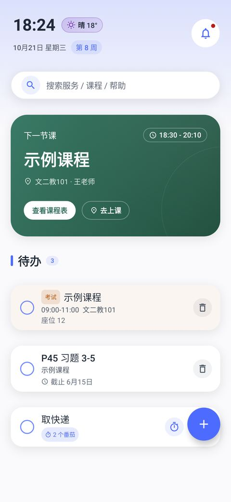
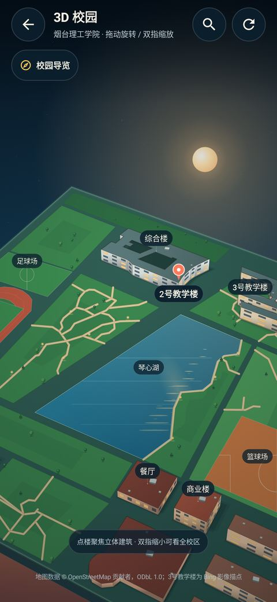
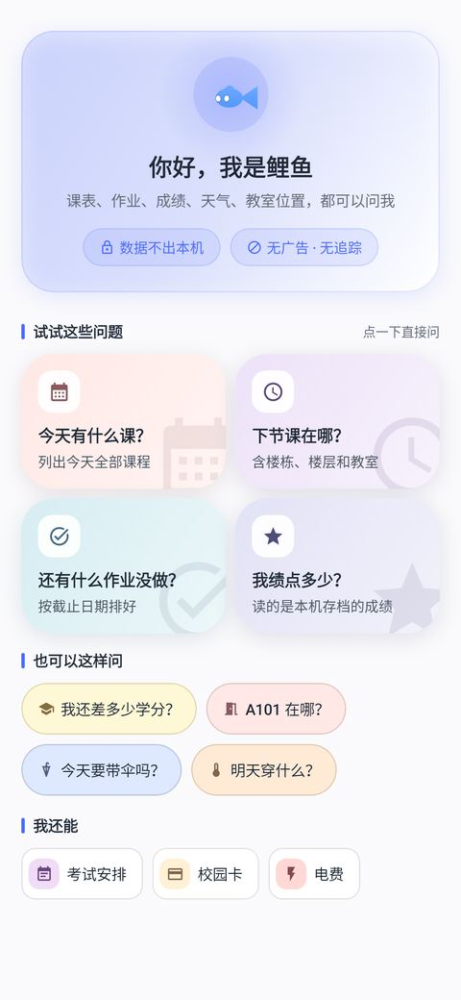
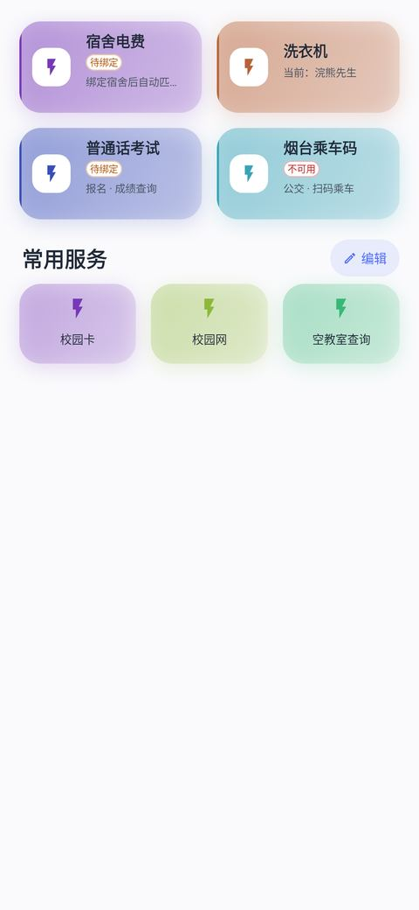
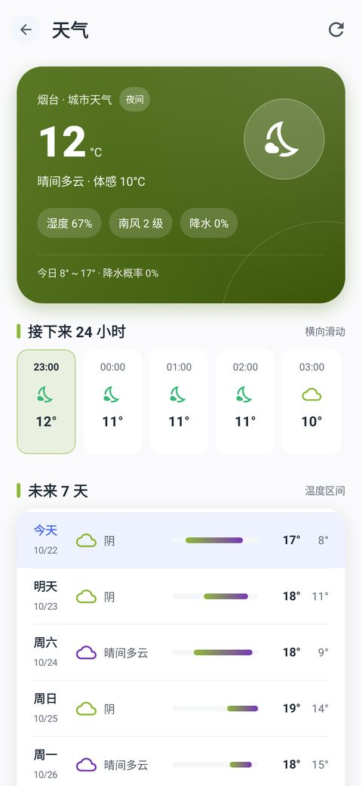
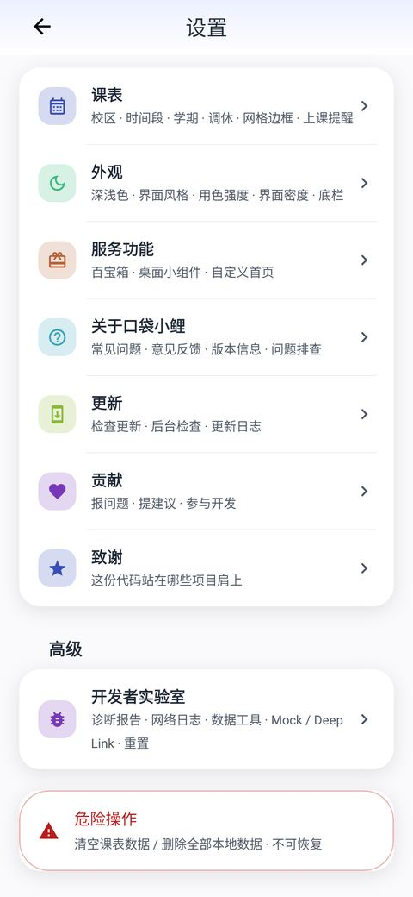

# 口袋小鲤

<p align="center">
  
  
  
  
</p>

面向**烟台理工学院**的 Android 校园助手。Kotlin + Jetpack Compose 原生开发，覆盖课表、成绩、服务聚合、校园地图与 AI 助手，**不经过任何自建业务中转服务器** —— 账号凭据与教务数据只在你手机和学校系统之间流动。

非官方项目，不代表学校；开源、无广告、无第三方统计/推送 SDK。

> [!NOTE]
> 本仓库**只放软件源码**（`app/`、构建配置、单元测试与截图基线、更新数据）。
> 设计文档、运维脚本、后端与内部笔记不在仓库内。

---

## 目录

| 目录 | 内容 |
|---|---|
| `app/` | Android 应用（Kotlin + Compose），含 2000+ 条单元测试与 190 张截图基线 |
| `gradle/`、`build.gradle.kts`、`settings.gradle.kts` | 构建配置（Gradle 9、AGP 9） |
| `announce/` | 更新与公告数据（`feed.json`、`promos.json`），客户端远程读取 |
| `docs/用户协议.md` | 用户协议的人读版（App 内为唯一真源） |
| `tools/promos.example.json` | 推广位配置样例（被单测读取） |

## 它能做什么

| 模块 | 能力 |
|---|---|
| 首页 | 下一节课倒计时、待办与考试、天气、全局搜索、消息（更新 + 公告） |
| 课表 | 周课表、调停课、当前周切换、导入/导出（ICS / 图片 / 日历）、桌面小组件 |
| 鲤鱼（AI 助手） | 自行配置模型与 Key；查课表、成绩、空教室、天气等；工具可单独开关；形象与表情可换 |
| 服务 | 成绩与修课查询、选课、空教室、教师查询、图书馆、热水、快递、校园卡、资料站、快问快答 |
| 校园地图 | 全屏 3D 沙盘（旋转/缩放）、楼栋档案与分层平面图、教室搜索、导览、室内平面图 |
| 我的 | 外观（9 套皮肤 / 深浅色 / 强调色）、更新与公告、意见反馈、用户协议 |
| 更新 | 双仓镜像 + 灰度 + 内测通道 + 断点续传 + SHA-256 校验，下载完先验再装 |

## 界面

<p align="center">
  
  
  
  
</p>

<p align="center">
  
  
</p>

<sub>以上是单元测试里的截图基线（Pixel 5 / 3x），不是效果图。</sub>

## 下载与更新

| 渠道 | 地址 |
|---|---|
| Gitee（主） | [gitee.com/liulin62633/pocket-carp/releases](https://gitee.com/liulin62633/pocket-carp/releases) |
| GitHub（备） | [github.com/LIULIN632/koudaixiaoli/releases](https://github.com/LIULIN632/koudaixiaoli/releases) |

两个渠道是**同一份字节**（每次发版都核对 SHA-256）。检查到新版本会先弹说明，由你决定是否下载；
下载失败会自动换另一个仓库重试，断开后可以接着下。

## 从源码构建

**环境**：JDK 21、Android SDK（`compileSdk 37`、`build-tools 37.0.0`）。

```bash
# Linux / macOS
./gradlew :app:assembleRelease

# Windows
.\build.ps1
```

- 仓库里**没有签名密钥**。在根目录放一份 `keystore.properties`（`storeFile` / `storePassword` / `keyAlias` / `keyPassword`）才会签名；
  没有它也能构建，只是产物未签名。
- `./gradlew :app:assembleRelease -Pfdroid=true` 生成 **F-Droid 版**：匿名运行统计完全不初始化（不建队列、不发请求），
  其余功能与正式版一致。普通构建不带这个属性，行为不变。
- `build.ps1` 是本项目的正式打包脚本：递增 `gradle.properties` 的版本号 → 构建 → 改名 → 校验签名。

## 测试

```bash
./gradlew :app:testDebugUnitTest
```

- 2000+ 条单元测试；其中约 190 张是 Compose 截图基线（`app/src/test/screenshots/`），
  改了观感需要 `-PrecordScreenshots` 重录并**看图**确认。
- 基线覆盖深浅色、窄屏（360dp）、大字号等边界。

## 隐私

- **课表、成绩、待办、笔记全部存本机**；`allowBackup="false"`，系统云备份不会带走它们。
- **学号与密码用 Android Keystore 加密后只存本机**（AES-256-GCM），不上传、不进日志。
- **无第三方广告 / 统计 / 推送 SDK**；崩溃日志只写在本机，是否导出由你决定。
- 唯一自动上报的是**匿名运行统计**（启动、更新、崩溃的次数与版本号，无设备标识、30 天换号），
  可在「我的 → 设置 → 关于 → 隐私」关闭；关掉后本机不再产生数据。
- 完整条款见 [用户协议与免责声明](docs/用户协议.md)，首次启动需同意。

## 许可与致谢

以 **GNU GPL v3.0** 发布，见 [LICENSE](LICENSE)。移植过的上游代码与素材、各自的许可证与义务见
[THIRD_PARTY_NOTICES.md](THIRD_PARTY_NOTICES.md)；感谢岱宗盒子、拾光课程表、DeepSeek-Bot、grok-ball、
LaoA-GrokBot、npface、MIUIX、Backdrop 等项目。

## 参与贡献

- 问题与建议：[GitHub Issues](https://github.com/LIULIN632/koudaixiaoli/issues)
- 提 PR 前先跑 `./gradlew :app:testDebugUnitTest`；截图基线有变要一并提交。
- 只服务烟台理工这一所学校，不接"支持多校"的贡献。
