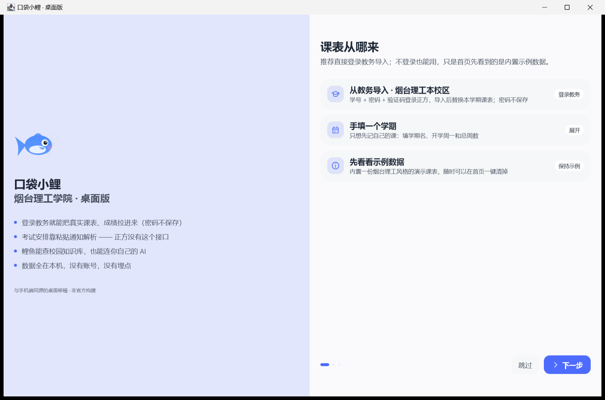
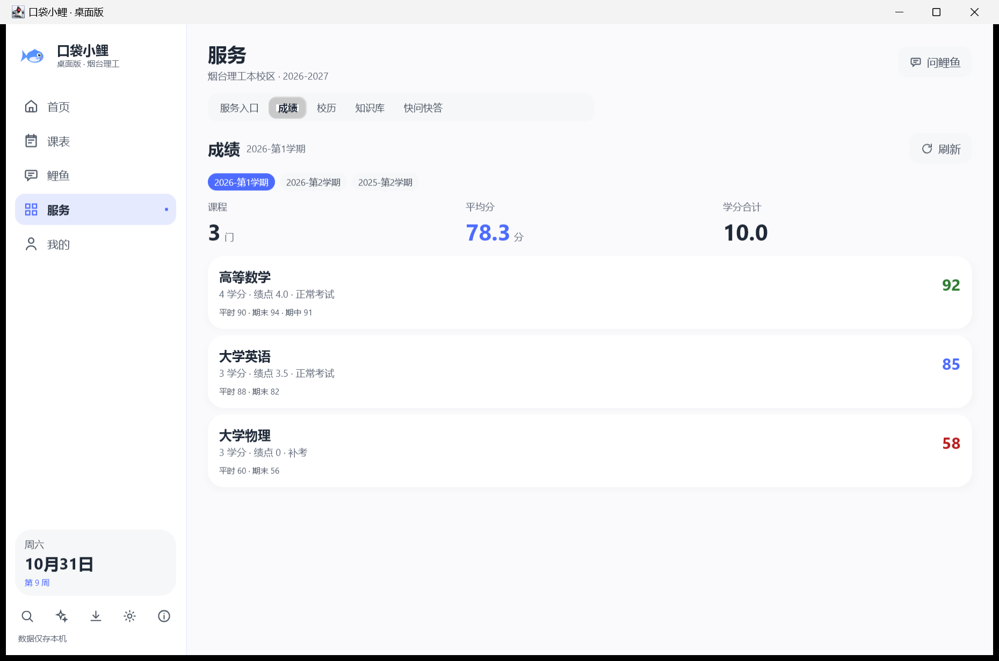
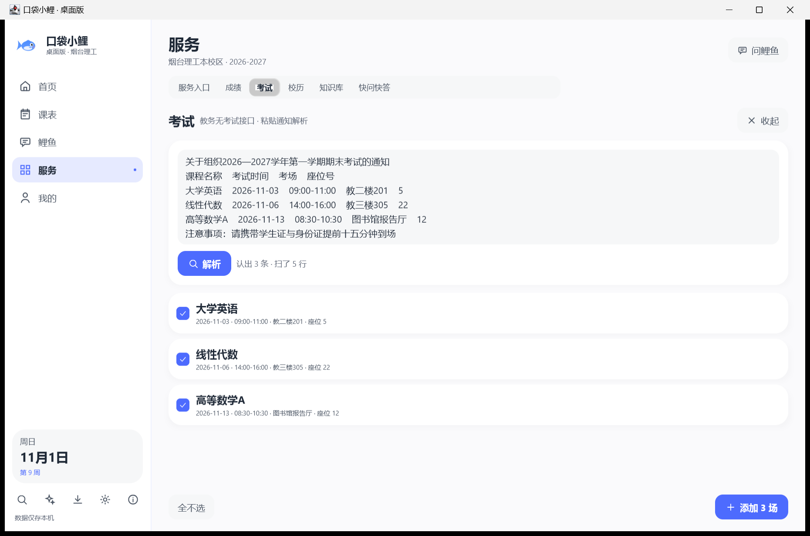

# 口袋小鲤 · 桌面版 使用手册

一页讲清「装好之后怎么用」。所有数据只写在本机
`%APPDATA%\PocketXiaoli\`，没有账号、没有上传、没有埋点。

---

## 1. 装好之后第一件事：把课表变成真的

首启引导第一步会问「课表从哪来」，三个选择：

| 选择 | 什么时候用 | 之后会看到 |
|---|---|---|
| **从教务导入**（推荐） | 你在烟台理工（正方 V8 教务）有学号密码 | 登录 → 输验证码 → 本学期课表覆盖进来，首页/课表/提醒全部换成真实数据 |
| **手填一个学期** | 只想先记自己的课，或者学校教务连不上 | 一个空学期，之后在课表页逐节新建 |
| **先看看示例数据** | 想先体验界面 | 内置演示课表，随时可在首页一键清掉 |

密码**不保存**：每次重启应用要重新登录（成绩有缓存，见第 3 节）。

---

## 2. 课表：能看也能改

- 课表页点任意一节课 → 编辑；点空白格子 → 在该时间新建。
- 新建/编辑时如果与已有课**时间撞上**，会先列出撞的那几门（含重合周次），再点一次「仍然保存」才会写进去 —— 单双周错开不算撞。
- 老师、教室输入框下面有候选条：点一下直接复用已有写法，省得手打一遍打成另一个名字（之后按老师筛就筛不到了）。
- 课表页顶部可以**按老师或教室筛选**：点一下某个老师，他的课保持高亮，其余格子弱化但仍看得见（不会"以为没课"），右侧显示「匹配 N 门」，再点一次或「清除筛选」还原。
- 「我的 → 节次时间」可以改每节课的起止时间；「我的 → 学期设置」改开学日和总周数，周次全应用跟着变。
- 「导出课表 ICS」按周展开，单双周与指定周次都准确，可以塞进系统日历。

---

## 3. 成绩：登录一次，之后能看缓存

服务 → 成绩：

- 未登录且没缓存 → 一张登录卡（学号 + 密码 + 验证码）。
- 登录后自动拉学期列表与成绩，显示课程数 / 平均分 / 学分合计 / 平均绩点，单科按分数换色（≥90 绿、<60 红）。
- 查过的学期会**缓存在本机**，而且**按学期各存一份**。下次打开不用登录也能看，但顶部会写明「缓存于 …」并提示不是实时数据；查过两个以上学期时，缓存视图上方会出现学期条，点一下就在缓存之间切（统计与缓存时间跟着换）。要最新结果点「重新登录」。
- 「导出 CSV」把当前显示的成绩存成带 BOM 的 CSV，Excel / WPS 直接打开不乱码。
- 缓存视图里点「清除本机成绩缓存」就不再显示旧成绩（要重新登录才能再查）；缓存本身存在本机数据文件里，跟着备份与导出一起走。

---

## 4. 考试：为什么不是「点一下就查」

**正方教务没有考试安排接口**（只有课表、成绩这类），考试信息只出现在教务通知正文或群里那张表里。所以这一页走的是手机端同一套链路：

1. 服务 → 考试 → 点「粘贴通知」；
2. 把通知整段粘进来（一行一场：课程 日期 时间 考场 座位）；
3. 点「解析」，会列出认出的每一条，并说明扫了几行；
4. 核对后点「添加」。**认不出日期的行不当考试** —— 错误的考试提醒比没有提醒更糟，所以必须过你一眼。

列表按开考日排序，倒计时换色：3 天内橙色、更远蓝色、没日期灰色、考完可以标「已完成」（也可一键删除）。开考前 3 天与考试当天各弹一次托盘提醒（「我的 → 提醒」可关）。

---

## 5. 待办

- 首页待办按截止日分桶：**已逾期 / 今天截止 / 本周内 / 以后 / 没填截止日**，已完成的折成一行，可以「清空已完成」（清前自动备份）。
- 新建待办时「关联课程」下面有课程名候选，点一下直接填。
- 日期写歪（`1.15`、`待定`）算「没填日期」，不会被误标成逾期。

---

## 6. 鲤鱼（AI）

- **没配 API Key 也能问**：校园事实题会走本机知识库与快问快答，答案末尾写明来源，并注明「没配 Key，联网问答不可用」。没收录就直说没收录，不编。
- 配了 Key（兼容任何 OpenAI 协议，默认 DeepSeek）才能联网推理；Key 只存本机。
- 课表、待办、校历、知识库这些工具调用不需要联网。

---

## 7. 出问题怎么办

按这个顺序来，别急着重装：

1. **提醒和提示出现在左侧栏底部**（日期卡上面那一格）：它不压在页面内容上，2.6 秒自己消失。没看到提示就是这一轮没有到期事项，不是坏了。
2. **先看「我的 → 数据」顶部的配置体检**：教务 / AI / 数据来源 / 启动 四行，缺哪项点哪项。
3. **导入课表少了或空了**：打开「我的 → 数据 → 导入诊断」，再导入一次。原始页面、学期参数、重定向链会存到
   `%APPDATA%\PocketXiaoli\logs\import-<时间>\`，点「打开诊断日志」就能看到。
   里面**不写密码、不写 Cookie**（密码字段整值打码，请求头一律不记）。
4. **导入后提示「这批课表看着不完整」**：这是防呆，不是坏了。它列出「将导入 N 门 · 覆盖 M 门 · 保留 K 条」。
   不确定就点「取消，保持原样」，先按第 2 步抓样本。
5. **要发给我排查**：点「导出诊断包」，把
   `%APPDATA%\PocketXiaoli\exports\diagnostic-<时间>.zip` 发过来。
   里面是 `notes.txt`（版本/JVM/数据形状/开关）、`app.log`（滚动日志）、导入诊断样本（若有）、
   以及**脱敏后的数据文件** —— `settings.aiApiKey` 一律替换成 `(已脱敏)`。
6. **双击图标没开出第二个窗口**：这是设计，不是没响应。数据是整份文件覆盖写的，两个进程同时开会互相
   盖掉对方的改动，所以第二次启动只负责把已经在跑的窗口（含最小化、收进托盘两种）叫到前台，自己退出。
   真需要同时开两个（比如对照两个学期），先把前一个窗口关掉。
7. **想彻底恢复**：「我的 → 数据 → 恢复示例数据」，或删掉 `%APPDATA%\PocketXiaoli\pocket-desktop.json`。
   每次导入/清空前都会自动备份成 `pocket-desktop.bak-<时间>.json`（留最近 10 份），改坏了能回退。

---

## 8. 天气与笔记

- **天气**：首页问候行下面一条，写的是**烟台（城市级）**—— 校区没有公开经纬度，界面不假装是文一教楼前实测的。数据来自开源的 Open-Meteo，免 Key、请求里只有坐标。半小时内重复打开直接用缓存（会写明「半小时前拉过」），拉不动就显示上一次的结果并说明原因，不会让那块天气凭空消失。右边刷新按钮可以强制重拉。
- **学习笔记**：服务页最后一个标签「笔记」。列表按更新时间倒序，标题空着会显示「未命名笔记」，正文空着显示「还没写内容」，不会给你一行空白以为丢了。点一行开弹窗编辑，保存即落本机。

---

## 9. 隐私边界（可以核对）

- 网络请求只有三类来源：你自己填的 AI 接口、配置里的教务/校园站点地址、以及**天气的 Open-Meteo**
  （固定公开端点，请求里只有烟台的经纬度与字段名，**不含设备号、账号、课表、位置权限**）。
  不想让它联网：「我的 → 数据 → 首页天气」关掉，就不再有任何天气请求，首页那条也一起消失。
- **只在本机监听一个回环端口**（`127.0.0.1:41827`）用来做单实例：程序不在外网监听、不接别的机器的连接，
  收发只有一行握手（`ACTIVATE` / `OK`），不带任何数据。端口被别的服务占用时会认出来并放弃这个守卫，不会误判。
- 不装服务、不上传；关闭窗口默认收进托盘（可在「我的 → 外观」关掉）。
- **开机自启默认关**：只有你在「我的 → 数据」里打开，才会写当前用户的注册表启动项 `HKCU\Software\Microsoft\Windows\CurrentVersion\Run`（值名 `PocketXiaoli`）；关掉即删除，不动系统级启动项。
- 教务密码只在一次登录请求里使用，不入库、不进日志、不进诊断包。
- 学号会出现在诊断样本里（复现课表接口必需），它不是凭据。
